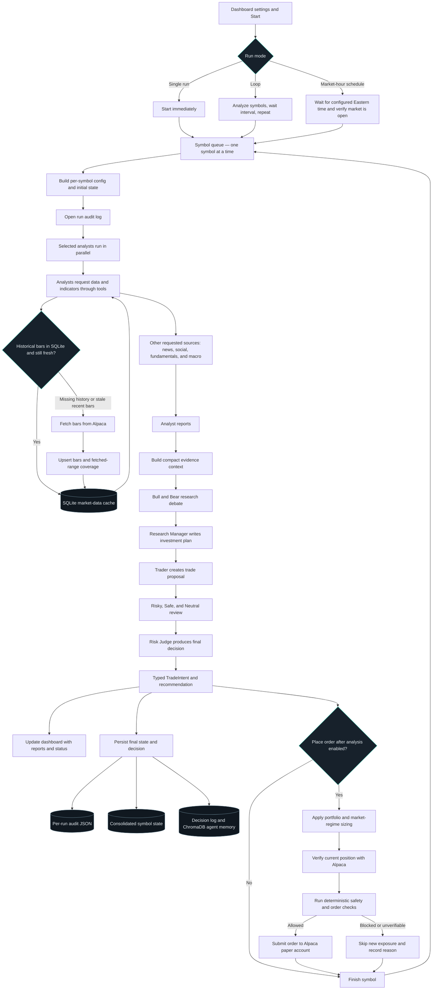

# Trading analysis pipeline

This diagram follows one symbol from the dashboard to its final decision. When multiple symbols are selected, the queue processes them one at a time; the selected analysts for each symbol run in parallel by default.

## Notes

- Analyst tool calls can lead to additional LLM calls. Their number depends on the evidence requested, so each run can take a different amount of time.
- The SQLite bar cache is persistent in Docker. It fills missing historical ranges and refreshes the recent two-day tail after its cache time-to-live expires. News and other non-bar sources may still be fetched on each analysis.
- The quick and deep LLM settings are separate roles in one run, not automatic error fallback models. The dashboard can override the configured defaults.
- Orders are attempted only when order execution is enabled and the deterministic safety checks allow them. Market-hour scheduling and loop state live in the running application process, so restarting the container does not resume an active schedule.

For the implementation details, see [ARCHITECTURE.md](../ARCHITECTURE.md), [graph setup](../tradingagents/graph/setup.py), [data cache](../tradingagents/dataflows/market_data_cache.py), and [order execution](../tradingagents/dataflows/alpaca_utils.py).
